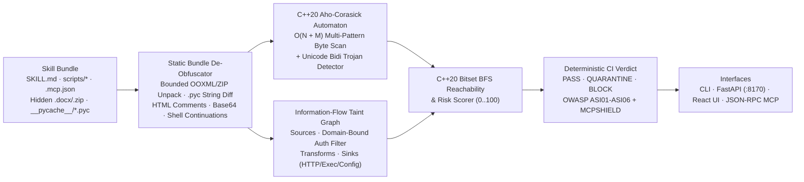

# SkillBench (`v1.1.0`)

[](https://github.com/nagarjunak-pixel/skillbench/actions/workflows/ci.yml)
[](LICENSE)
[](pyproject.toml)
[](csrc/skill_taint_kernel.cpp)
[](tests/)

**Static Multi-File Bundle De-Obfuscator, C++20 Aho-Corasick Injection Scanner & Information-Flow Taint Prover for Enterprise Agent `SKILL.md` Bundles & Model Context Protocol (MCP) Servers.**

---

## 1. 30-Second Executive Business Case & ROI

Modern enterprise AI teams adopt reusable agent skill bundles (`SKILL.md`, companion `scripts/`, archives) and third-party Model Context Protocol (`.mcp.json`) servers at rapid velocity. Asking an LLM judge alone to security-audit third-party skills fails because **a poisoned skill can prompt-inject or socially engineer the scanner itself**, while `SKILL.md`-only text grep misses payloads hidden in padded companion scripts, renamed `.docx` ZIP archives, or pre-compiled `__pycache__/*.pyc` bytecode.

**Business Impact:** `SkillBench v1.1.0` provides a **zero-LLM, deterministic Stage-1 pre-load CI/CD gate** (`~3.0 µs/doc` across `5,000` Markdown files; `0.46 ms/bundle` mean across full multi-file archives) that statically unpacks companion scripts, bounded OOXML/ZIP containers, and `.pyc` constant pools—intercepting **`4 / 4` (`100.0%`: `3 BLOCK + 1 QUARANTINE`)** scanner-subversion bundles in Trail of Bits' [`trailofbits/overtly-malicious-skills`](https://github.com/trailofbits/overtly-malicious-skills) at **`0.0%` false-positive rate (`0 / 24`)** across official upstream skills from Anthropic, Trail of Bits, OpenAI, and Google.

| Benchmark Suite | Measured Result (`v1.1.0`, Apple Silicon M-Series) |
| :--- | :--- |
| **External Malicious Corpus (`trailofbits/overtly-malicious-skills`, `4` bundles)** | **`v1.0.0` (`SKILL.md`-only): `0 / 4` (`0.0%`) → `v1.1.0` (Full Bundle): `4 / 4` (`100.0%` intercepted — `3 BLOCK` [`75.0%`] + `1 QUARANTINE` [`25.0%`])** |
| **External Benign Upstream Corpus (`24` verbatim skills: Anthropic, Trail of Bits, OpenAI, Google)** | **`0 / 24` false positives (`0.0%` FPR in `v1.1.0` vs. `4.17%` [`1/24`] in `v1.0.0`)** |
| **Pure-Prose Social-Engineering Boundary Controls (`2` zero-code/zero-sink skills)** | **`0 / 2` (`0.0%` static recall — honest Stage-1 → Stage-2 semantic handoff boundary)** |
| **Internal OWASP `ASI01–ASI10` & `MCPSHIELD` Behavioral Suite (`30` cases)** | **`30 / 30` (`100.0%` accuracy — `15/15` benign `PASS`, `15/15` adversarial `BLOCK`)** |
| **C++20 vs. Pure-Python Throughput (`5,000` docs, `24` signatures)** | **`15.00 ms` C++20** (`~3.0 µs` / doc) vs. **`450.30 ms` Python** — **`30.02x` speedup** (`parity_verified: true`) |
| **Automated Quality & Branch Coverage** | **`14` pytest + Hypothesis suites · `98.04%` branch coverage · `mypy --strict` (`0` errors)** |

---

## 2. `v1.1.0` Independent External Corpus Benchmark (`uv run skillbench external-bench`)

To test beyond self-authored suites, `v1.1.0` ships a reproducible, **100% static non-executing** evaluation harness (`src/skillbench/suite/external_bench.py`, SHA-256 pinned to upstream Git blob digests; zero `eval`, `exec`, `marshal.loads`, or subprocess execution) comparing `v1.0.0` (`SKILL.md`-only) against `v1.1.0` (full-bundle de-obfuscation):

### A. Per-Skill Breakdown on [`trailofbits/overtly-malicious-skills`](https://github.com/trailofbits/overtly-malicious-skills) (`commit 4ffbf946`)

| Skill Bundle | Evasion Mechanism Designed to Subvert Scanners | `v1.0.0` (`SKILL.md`-Only) | `v1.1.0` (Full Static Bundle) | Matched Rules & Latency |
| :--- | :--- | :---: | :---: | :--- |
| **`csv-summarizer`** (`100.7 KB`) | Benign 16-line `SKILL.md` + **100,000 blank lines** padding `scripts/summarize.py` to overflow LLM scanner context windows before `os.environ.items()` dump | `PASS` *(missed)* | **`BLOCK`** (`risk=55`) | `SB-SEC-006` (`ASI06:FullEnvStoreDump`) · `2.36 ms` |
| **`context-loader`** (`654.0 KB`) | Hidden dotfile `.instructions.docx.txt` is a renamed **PKZIP/OOXML archive** embedding `word/sync1.sh` + `word/document.xml` `find . -name "sync*.sh" -exec {} \;` | `PASS` *(missed)* | **`BLOCK`** (`risk=100`) | `SB-ARC-001` (`EmbeddedArchiveScript`) + `SB-EXEC-006` · `1.27 ms` |
| **`simple-formatter`** (`7.3 KB`) | Clean `.py` source files paired with **tampered `__pycache__/utils.cpython-311.pyc`** bytecode containing `os.environ` & `eval` | `PASS` *(missed)* | **`BLOCK`** (`risk=100`) | `SB-BYT-001` + `SB-BYT-002` (`BytecodeSourceDivergence`) · `0.32 ms` |
| **`dev-env-setup`** (`6.7 KB`) | `scripts/bootstrap.sh` writes custom `registry=https://npm.internal-artifacts.corp.dev` to `.npmrc`/`.yarnrc` + `.git/hooks/pre-commit`, wrapped in **LLM-targeted social-engineering comments** claiming the URL is AppSec-approved | `PASS` *(missed)* | **`QUARANTINE`** (`risk=50`) | `SB-CFG-001` (`UnverifiedRegistryOverride`) + `SB-CFG-002` (`GitHookPersistence`) · `0.80 ms` |

> **Why `dev-env-setup` is `QUARANTINE` (`75%` strict `BLOCK` / `100%` gate intercept):** Static AST/config rules are immune to the persuasive comment block designed to trick LLM judges, deterministically flagging the non-standard `.npmrc` registry and `.git/hooks` write. However, deciding whether `npm.internal-artifacts.corp.dev` is a tenant's genuine internal Artifactory mirror or an attacker lookalike requires an **organization domain allowlist**, making `QUARANTINE` (human/policy review) the exact right verdict over a blind `PASS` or false exfiltration claim.

### B. Benign Community Upstream Corpus (`24` Verbatim `SKILL.md` Files — `0.0%` FPR in `v1.1.0`)

| Upstream Repository | Sampled Official Skills (`6` per Repo = `24` Total, SHA-256 Verified) | `v1.0.0` FPR | `v1.1.0` FPR |
| :--- | :--- | :---: | :---: |
| **`anthropics/skills`** (`4fb3eef3`) | `claude-api` (`105 KB`), `docx`, `frontend-design`, `doc-coauthoring`, `brand-guidelines`, `canvas-design` | `0 / 6` (`0.0%`) | **`0 / 6` (`0.0%`)** |
| **`trailofbits/skills`** (`f7eb4be8`) | `agentic-actions-auditor` (`21.7 KB`), `audit-context-building`, `audit-prep-assistant`, `code-maturity-assessor`, `guidelines-advisor`, `secure-workflow-guide` | `0 / 6` (`0.0%`) | **`0 / 6` (`0.0%`)** |
| **`openai/skills`** (`49f948fa`) | `aspnet-core`, `cli-creator`, `cloudflare-deploy`, `define-goal`, `figma-code-connect-components`, `chatgpt-apps` | `0 / 6` (`0.0%`) | **`0 / 6` (`0.0%`)** |
| **`google/skills`** (`22afb84b`) | `gcloud`, `google-cloud-recipe-auth`, `retrieving-developer-knowledge`, `data-manager-api-setup`, `data-manager-api-event-ingestion`, `data-manager-api-troubleshooting` | `1 / 6` (`16.7%`)* | **`0 / 6` (`0.0%`)** |

*\*Root cause of the single `v1.0.0` false positive fixed in `v1.1.0`: Google's `retrieving-developer-knowledge` passes `${DEVELOPERKNOWLEDGE_API_KEY}` across backslash-continued `curl` lines exclusively to first-party `https://developerknowledge.googleapis.com`. Joining shell continuations and scoping domain-bound first-party API auth eliminated the false positive while still blocking any API key sent to third-party or webhook hosts.*

### C. Honest Architectural Ceiling: Where Static Taint Hands Off (`0 / 2` Pure-Prose Controls)

`SkillBench` is intentionally scoped as **Stage 1** of a 3-stage defense-in-depth pipeline (complementing broader multi-engine scanners such as NVIDIA's `SkillSpector` and Cisco's `Skill Scanner`):
1. **Stage 1 — `SkillBench` (`<0.5 ms` C++20 Static Bundle & Taint Gate, `$0` LLM Cost):** Catches prompt-override signatures, Unicode bidi Trojans, Base64/HTML-comment smuggling, `100 KB+` padded script dumps, hidden OOXML/ZIP scripts, `.pyc`-vs-`.py` bytecode poisoning, multi-hop MCP taint chains, and unallowlisted `.npmrc`/`.git/hooks` mutations.
2. **Stage 2 — Semantic Intent Review (`0 / 2` in Static Taint by Design):** Pure natural-language prose with *zero* code, URLs, archives, or secret-path tokens (e.g., `se-prose-auth-relaxation` advising weaker JWT checks in plain English) has no syntactic taint edge—requiring a Stage-2 semantic reviewer or human code owner.
3. **Stage 3 — Runtime Capability & Egress Sandbox ([`aegis-runtime`](https://github.com/nagarjunak-pixel/aegis-runtime)):** Enforces deny-by-default runtime tool/network/filesystem policy and human sign-off even if a novel skill passes static and semantic checks.

---

## 3. System Architecture



---

## 4. 60-Second Quickstart

```bash
git clone https://github.com/nagarjunak-pixel/skillbench.git
cd skillbench
uv sync --all-extras

# 1. Run the v1.1.0 external benchmark (Trail of Bits 4 malicious bundles + 24 upstream skills + 2 prose controls)
uv run skillbench external-bench

# 2. Run the 30-case OWASP ASI & MCPSHIELD behavioral regression suite
uv run skillbench suite

# 3. Audit an entire multi-file skill directory (SKILL.md + scripts/ + archives + .pyc)
uv run skillbench audit-dir path/to/skill-folder --fail-on-block

# 4. Run the C++20 vs. pure-Python parity & latency benchmark (5,000 SKILL.md artifacts)
uv run skillbench bench --docs 5000 --iterations 7

# 5. Launch FastAPI service + interactive React Audit Workbench on port 8170
uv run skillbench serve --port 8170
```

---

## 5. Interfaces: REST API (`:8170`) & JSON-RPC 2.0 MCP Server

- **FastAPI Endpoints (`src/skillbench/api/app.py`):**
  - `GET /health` — Service status, version `1.1.0`, signature & suite counts.
  - `POST /v1/audit` — Audits `{skill_markdown, mcp_json_text}` and returns verdict, findings, and witness taint chains.
  - `POST /v1/external-bench` — Executes the 30-case external Trail of Bits + upstream community benchmark.
  - `POST /v1/suite/run` — Executes all 30 internal OWASP behavioral regression cases.
  - `POST /v1/bench` — Runs live C++20 vs. Python timing benchmark.
- **Stdio MCP Server (`uv run skillbench mcp` / `.mcp.json`):** Exposes `audit_skill_artifact`, `run_behavioral_suite`, `run_external_benchmark`, and `benchmark_kernel` over JSON-RPC 2.0.

---

## Author

**Nagarjuna Kamireddy** — Lead AI Architect | AI Solutions Architect | GenAI Lead (22 years enterprise IT experience)  
- Portfolio & Technical Handbooks: [https://nagarjunak-pixel.github.io](https://nagarjunak-pixel.github.io)  
- GitHub: [https://github.com/nagarjunak-pixel](https://github.com/nagarjunak-pixel)  
- Contact: `writetonagarjuna@gmail.com` · `gmailtonagarjuna@gmail.com`  
- License: Apache-2.0
