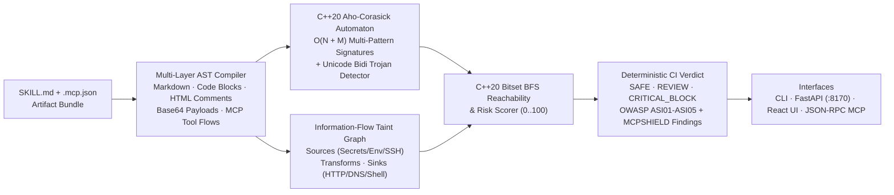

# SkillBench (`v1.0.0`)

[](https://github.com/nagarjunak-pixel/skillbench/actions/workflows/ci.yml)
[](LICENSE)
[](pyproject.toml)
[](csrc/skill_taint_kernel.cpp)
[](tests/)

**Static Information-Flow Taint Analyzer, C++20 Aho-Corasick Obfuscation/Injection Scanner & Behavioral Regression Harness for Enterprise Agent `SKILL.md` Bundles & Model Context Protocol (MCP) Servers.**

---

## 1. 30-Second Executive Business Case & ROI

Modern enterprise AI teams adopt reusable agent skill bundles (`SKILL.md`, prompt templates, shell helpers) and third-party Model Context Protocol (`.mcp.json`) servers at rapid velocity. A single poisoned skill or shadow MCP tool configuration creates the **Agentic Lethal Trifecta**:
1. **Untrusted instructions / obfuscated payloads** (Base64 shell pipes, Unicode bidirectional Trojan overrides, prompt-override directives),
2. **Privileged internal data sources** (`~/.ssh`, `.aws/credentials`, `.env` vaults, ERP/CRM secrets), and
3. **Unrestricted external network sinks** (`curl`/`wget`, raw webhooks, DNS tunnels, external email relays).

**Business Impact:** `SkillBench` acts as a **deterministic pre-deployment CI/CD security gate** (blocking compromised skills in `<15 ms` across `5,000` artifacts with **zero LLM token spend** and **`0.0%` false-positive rate** on legitimate developer skills), eliminating credential exfiltration and supply-chain compromise before any agent runtime loads an untrusted skill or MCP manifest.

| Metric | Measured Result (`v1.0.0`, Apple Silicon M-Series) |
| :--- | :--- |
| **30-Case Behavioral & Adversarial Suite** | **`30 / 30` (`100.0%` accuracy — `15/15` benign `SAFE`, `15/15` adversarial `CRITICAL`/`BLOCK`)** |
| **Adversarial Exfiltration Recall** | **`100.0%`** (direct secret-to-webhook, 2-hop MCP tool chains, Base64 shell, Unicode bidi Trojans, HTML comment prompt injection) |
| **Benign Developer Skill False-Positive Rate** | **`0.0%`** (read-only linters, local file formatters, internal allowlisted status checks, local pytest runners) |
| **C++20 vs. Pure-Python Throughput (`5,000` docs)** | **`14.454 ms` C++20** (`~0.0029 ms` / doc) vs. **`420.234 ms` Python** — **`29.07x` speedup** (`parity_verified: true`) |
| **Automated Test & Branch Coverage** | **`11` pytest + Hypothesis property suites · `98.20%` branch coverage · `mypy --strict` clean** |

---

## 2. System Architecture



### Core Engineering Highlights
- **Dual-Engine Bit-Exact Parity (`csrc/skill_taint_kernel.cpp` + `src/skillbench/kernel/bridge.py`):** Compiles `-std=c++20 -O3` Aho-Corasick trie + 64-bit word-packed bitset BFS taint reachability kernel automatically via `ctypes`, with a bit-identical pure-Python reference engine verified continuously via Hypothesis property-based tests.
- **Multi-Layer De-Obfuscation (`src/skillbench/compiler/parser.py`):** Inspects visible Markdown prose, fenced code blocks, hidden `<!-- HTML comments -->`, decoded Base64 payloads, Unicode bidirectional override codepoints (`U+202A..U+202E`, `U+2066..U+2069`), and multi-hop `.mcp.json` `explicit_flows` chains (preserving neutral intermediate transform hops so `read_secret_vault -> format_msg -> post_external_webhook` is caught deterministically).
- **OWASP Agentic Top-10 & `MCPSHIELD` Mapping:** Every finding emits structured rule IDs (`ASI01` Goal Hijack / Prompt Injection, `ASI02` Tool Misuse & Exfiltration, `ASI04` Supply-Chain Obfuscation, `ASI05` Arbitrary Code Execution) with witness source-to-sink paths.

---

## 3. 60-Second Quickstart

```bash
git clone https://github.com/nagarjunak-pixel/skillbench.git
cd skillbench
uv sync --all-extras

# 1. Run the 30-case benign + adversarial behavioral suite
uv run skillbench suite

# 2. Run the C++20 vs. pure-Python parity & latency benchmark (5,000 SKILL.md artifacts)
uv run skillbench bench --docs 5000 --iterations 7

# 3. Audit a SKILL.md file (and optional .mcp.json manifest) from CLI
uv run skillbench scan path/to/SKILL.md --mcp path/to/.mcp.json

# 4. Launch FastAPI service + interactive React Audit Workbench on port 8170
uv run skillbench serve --port 8170
```

---

## 4. Interfaces: REST API (`:8170`) & JSON-RPC 2.0 MCP Server

- **FastAPI Endpoints (`src/skillbench/api/app.py`):**
  - `GET /health` — Kernel status (`cpp20_loaded`), port `8170`, version `1.0.0`.
  - `POST /api/v1/analyze` — Audits `{name, skill_markdown, mcp_manifest}` and returns risk score, verdict, witness taint chains, and findings.
  - `GET /api/v1/suite` — Executes all 30 regression cases and returns precision/recall/FPR metrics.
  - `POST /api/v1/benchmark` — Runs live C++20 vs. Python timing benchmark.
- **Stdio MCP Server (`uv run skillbench mcp` / `.mcp.json`):** Exposes `audit_skill_bundle` and `run_regression_suite` over JSON-RPC 2.0 so coding agents can self-audit third-party skills prior to installation.

---

## 5. Quality & Verification Gates

```bash
uv run ruff format --check src tests
uv run ruff check src tests
uv run mypy src tests
uv run pytest --cov=skillbench --cov-report=term-missing --cov-fail-under=95
cd ui && npm ci && npm run build
```

---

## Author

**Nagarjuna Kamireddy** — Lead AI Architect | AI Solutions Architect | GenAI Lead (22 years enterprise IT experience)  
- Portfolio: [https://nagarjunak-pixel.github.io](https://nagarjunak-pixel.github.io)  
- GitHub: [https://github.com/nagarjunak-pixel](https://github.com/nagarjunak-pixel)  
- Contact: `writetonagarjuna@gmail.com` · `gmailtonagarjuna@gmail.com`  
- License: Apache-2.0
